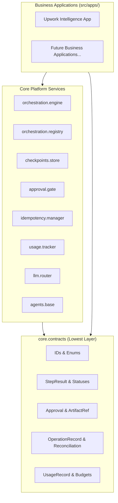
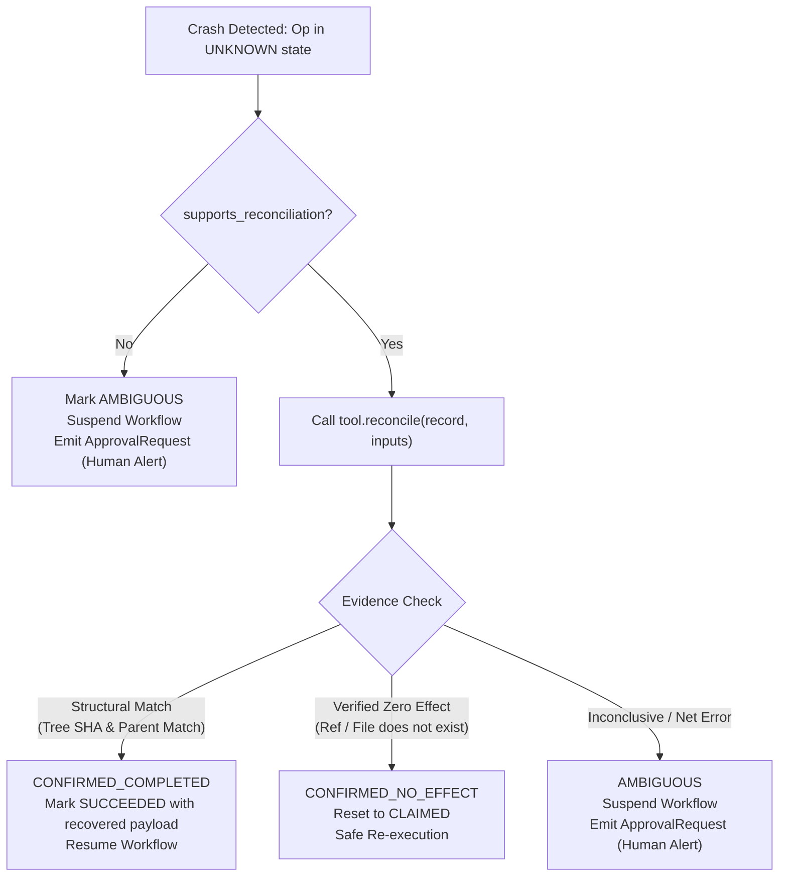

# AI Development Orchestrator — Architecture & System Design

**Status:** Approved Architecture (V2 Final)  
**Target Runtime:** Python 3.12 | Pydantic v2  
**Architecture Pattern:** Modular Monolith with Inversion of Control (Plugin Architecture)

---

## 1. System Overview & Core Philosophy

The **AI Development Orchestrator** is a modular platform designed to coordinate technical software development workflows executed by AI agents (e.g., requirement analysis, architecture design, code generation, testing, code review, and artifact release).

### Core Architectural Decisions:
1. **Modular Monolith**: Single repository, single deployable unit initially. No premature microservices.
2. **Strict Inversion of Control**:
   - `src/core/` is domain-agnostic and maintains **zero imports** from business applications (`src/apps/`).
   - Business applications import Core interfaces and register workflows, steps, and agents into Core registries upon startup.
3. **Deterministic Resumption**: Workflows execute as sequential state machines over registered step functions. Interrupted workflows resume deterministically from checkpointed state snapshots without repeating completed steps.
4. **Honest Accounting & Two-Phase Budgeting**: Token consumption, latency, and costs are tracked as first-class primitives. Budget reservation prevents rogue overspend *before* network dispatch.
5. **Robust Operation-Level Idempotency**: Atomic leases, heartbeat tracking, monotonic fencing tokens, and a *reconcile-before-retry* protocol safeguard external side-effects (Git commits, file patches, builds) against duplicate execution and crashes.

---

## 2. System Directory Structure

```text
ai-development-orchestrator/
├── docs/
│   └── ARCHITECTURE.md           # This document
├── src/
│   ├── core/                     # Reusable Orchestration Platform (Domain-Agnostic)
│   │   ├── contracts/            # Pure data contracts, enums, exceptions, IDs (Lowest level)
│   │   │   ├── ids.py            # Typed identifiers (RunId, OperationId, etc.)
│   │   │   ├── status.py         # WorkflowStatus, TaskStatus, ApprovalStatus
│   │   │   ├── approval.py       # ArtifactRef, ApprovalRequest, ApprovalDecision
│   │   │   ├── step.py           # StepResult, TaskStatus
│   │   │   ├── errors.py         # TransientError, PermanentError, RetryPolicy
│   │   │   ├── checkpoint.py     # CheckpointRecord schema
│   │   │   ├── usage.py          # UsageRecord, BillingType, CostStatus
│   │   │   └── idempotency.py    # OperationRecord, ReconciliationResult
│   │   ├── orchestration/        # Workflow execution engine
│   │   │   ├── metadata.py       # Serializable workflow & step metadata
│   │   │   ├── registry.py       # Composite-key registry (workflow_id, version)
│   │   │   └── engine.py         # Sequential runner, state machine transitions
│   │   ├── checkpoints/          # State persistence
│   │   │   ├── store.py          # CheckpointStore protocol & JSON/SQLite store
│   │   │   └── store_sqlite.py   # SQLite implementation
│   │   ├── approval/             # Human-in-the-loop verification
│   │   │   └── gate.py           # Hash validation and approval lifecycle engine
│   │   ├── idempotency/          # Operation lifecycle & lease management
│   │   │   ├── store.py          # Atomic lease acquisition & heartbeat tracker
│   │   │   └── manager.py        # Reconcile-before-retry coordinator
│   │   ├── usage/                # Usage ledger & budget enforcement
│   │   │   ├── tracker.py        # Token counter & reservation reconciler
│   │   │   └── pricing.py        # Configurable pricing registry
│   │   ├── llm/                  # Provider abstraction & capability routing
│   │   │   ├── router.py         # Model capability resolver (FAST, BALANCED, REASONING)
│   │   │   ├── client.py         # BaseLLMClient protocol
│   │   │   ├── gemini.py         # Google Gemini adapter
│   │   │   └── claude.py         # Anthropic Claude adapter
│   │   └── agents/               # Agent execution context & registry
│   │       ├── base.py           # BaseAgent protocol & runtime context
│   │       └── registry.py       # AgentRegistry
│   │
│   ├── apps/                     # Isolated Business Applications
│   │   └── upwork/               # First reference application
│   │       ├── models/           # Domain schemas (JobPosting, ProposalArtifact)
│   │       ├── agents/           # ScorerAgent, ProposalWriterAgent
│   │       ├── workflows/        # Step callables & business rules
│   │       └── register.py       # Registration bootstrap entry point
│   └── main.py                   # Platform bootstrap & CLI runner
├── tests/
│   ├── core/                     # Unit & integration tests for Core platform
│   └── apps/                     # Application-specific tests
├── requirements.txt
└── README.md
```

---

## 3. Module Boundaries & Dependency Inversion



**Architectural Rule**: `core.contracts` depends **only** on the Python standard library and Pydantic. `src/core/` must never contain import statements pointing to `src/apps/`.

---

## 4. Lifecycle State Machines & Identifiers

### 4.1 Identity Hierarchy
* **`run_id`**: Unique UUID for a single workflow execution.
* **`business_entity_id`**: External domain identifier (e.g., job URL, ticket ID). One business entity can have multiple workflow runs over time.
* **`step_id`**: Logical step identifier in a workflow (e.g., `draft_proposal`).
* **`attempt_number`**: Step-level retry counter.
* **`operation_id`**: Unique UUID for a physical attempt to execute a tool operation.
* **`idempotency_key`**: Deterministic SHA-256 digest ensuring deduplication of identical operations.

### 4.2 Independent Lifecycles

```
Workflow Lifecycle:
  PENDING ──► RUNNING ──► COMPLETED
                 │   ▲
                 ▼   │ (approval granted / resume)
             SUSPENDED
                 │
                 ├──► FAILED (unrecoverable error)
                 └──► CANCELLED (human rejected)

Task / Step Lifecycle:
  PENDING ──► RUNNING ──► SUCCESS
                 │   ├──► WAITING_APPROVAL
                 │   ├──► SKIPPED
                 │   └──► FAILED (retries exhausted)

Approval Ticket Lifecycle:
  PENDING ──► APPROVED
     │    ├──► REJECTED
     │    ├──► CHANGES_REQUESTED (loops back to revision step)
     │    └──► EXPIRED (underlying artifact was modified)
```

---

## 5. Step Execution, State Mutation & Checkpointing

### 5.1 Step Execution Contract
Steps return an explicit `StepResult` envelope. `updated_state` is a **partial patch** shallow-merged into the workflow's state dictionary:

```python
class StepResult(BaseModel):
    status: TaskStatus
    updated_state: dict[str, Any] = Field(default_factory=dict)
    approval_request: ApprovalRequest | None = None
    skip_reason: str | None = None
    error_message: str | None = None
    idempotency_key: str | None = None
```

### 5.2 Post-Step Validation & Checkpointing
1. **Merge & Validate**: Following execution of a step, Core shallow-merges `StepResult.updated_state` into the existing state. Core then immediately validates the resulting dictionary against the registered workflow's Pydantic `state_schema`.
2. **Atomic Checkpoint**: The validated snapshot is persisted in a `CheckpointRecord`:
   - `run_id`, `workflow_id`, `workflow_version`
   - `sequence_number` (monotonic counter)
   - `current_step_name`, `next_step_index`
   - `workflow_status`
   - `state_snapshot` (full validated state)
   - `state_schema_version`
   - `pending_approval` context (if status is `SUSPENDED`)

### 5.3 Resumption Guarantees
- Resumption loads the highest `sequence_number` checkpoint.
- **Workflow Version Check**: Core queries `WorkflowRegistry.get(run.workflow_id, run.workflow_version)`. If that exact version is missing, Core refuses execution and raises `WorkflowVersionNotFoundError`.
- **Atomic Concurrency Lock**: Resuming requires an atomic CAS transition (`SUSPENDED -> RUNNING`). Concurrent resumes fail with `ConcurrentExecutionError`.

---

## 6. Human Approval & Artifact Versioning

To prevent approving stale or drifted artifacts:

1. **Artifact Reference (`ArtifactRef`)**:
   Contains `artifact_id`, `artifact_version` (integer), and `artifact_hash` (SHA-256 of canonical JSON content).
2. **Approval Request**:
   The step emits an `ApprovalRequest` specifying an `ApprovalContinuation`:
   - `on_approve_next_step`: Next sequential step
   - `on_reject_status`: Typically `CANCELLED`
   - `on_changes_requested_step`: Step name to loop back to (e.g., `draft_proposal`)
3. **Verification on Decision**:
   - The reviewer submits `ApprovalDecision(reviewed_hash=...)`.
   - Core computes the current artifact hash from the state snapshot. If `reviewed_hash != current_artifact_hash`, Core marks the request `EXPIRED` and rejects the decision.
4. **`REQUEST_CHANGES` Loop-Back**:
   When changes are requested, Core updates the step pointer to `on_changes_requested_step`, merges feedback into the state, and re-executes. The revision step increments `artifact_version`, recomputes the new hash, and yields a fresh `ApprovalRequest`.

---

## 7. Operation-Level Idempotency & Crash Recovery

### 7.1 Idempotency Key Formulation
$$\text{idempotency\_key} = \text{sha256}(\text{scope} + \text{operation\_type} + \text{operation\_version} + \text{input\_digest})$$
- Changing **any** input (diff, commit message, prompt, parent commit) alters `input_digest`, generating a new key and executing fresh work.
- Retrying an identical step attempt reuses the exact key, allowing Core to return cached results (`Short-Circuiting`).

### 7.2 Concurrency, Leases & Fencing
- Workers claim operations using atomic CAS (`status = CLAIMED`, `lease_epoch = lease_epoch + 1`, `lease_expires_at = now() + TTL`).
- Monotonic `lease_epoch` serves as an MVP fencing token: stale workers attempting to commit after a timeout are rejected.

### 7.3 Crash Recovery: Reconcile-Before-Retry
When an operation is left in `IN_FLIGHT` after a crash and its lease expires, Core marks it `UNKNOWN`:



### 7.4 LLM Limitations (No False Promises)
Core explicitly acknowledges that standard LLM completions cannot guarantee exactly-once execution or zero duplicate billing over network timeouts. Core mitigates duplicate spend via local scratch buffers and client request-id tracing where supported, while treating indeterminate timeouts as `AMBIGUOUS`.

---

## 8. Usage Accounting, Two-Phase Budgeting & Model Routing

### 8.1 Two-Phase Budget Enforcement
To prevent unconstrained token consumption:
1. **Pre-Call Reservation**: Core estimates worst-case tokens: $\text{prompt\_tokens} + \text{max\_output\_tokens}$. It verifies and reserves this against Task, Agent, and Workflow budget ledgers. If budget is exceeded, execution is halted *before* network I/O.
2. **Mandatory Output Caps**: Every LLM invocation enforces an explicit `max_tokens` parameter.
3. **Post-Call Reconciliation**: Actual tokens consumed replace the reservation; unused headroom is released.
4. **Honest Billing Truth**: Calls under flat-rate subscriptions or unmetered tiers record actual tokens but set `estimated_cost = None` and `billing_type = SUBSCRIPTION`. Pricing tables are dynamically injected, never hardcoded.

### 8.2 Capability-Based Model Routing
Business agents never request concrete provider model strings. Agents request a **`ModelCapability`**:
- `FAST`: High throughput, low latency (filtering, linting, parsing).
- `BALANCED`: General reasoning, code review, scoring.
- `REASONING`: Complex multi-step synthesis, architecture design, proposal generation.

Core resolves capabilities to providers (`google` / `anthropic`) via configuration, allowing zero-code provider switches.

---

## 9. LangGraph Future Integration Path

LangGraph is deferred post-MVP. When needed, forward compatibility is achieved via an adapter pattern without modifying business workflows:

```python
def to_langgraph_node(step_name: str, step_callable: RuntimeStepCallable):
    async def node_fn(state: dict) -> dict:
        result: StepResult = await step_callable(state)
        if result.status == TaskStatus.WAITING_APPROVAL:
            raise LangGraphInterrupt(result.approval_request)
        return result.updated_state
    return node_fn
```

---

## 10. MVP Acceptance Criteria

### Core Platform Verification:
- [ ] **Dependency Boundary**: Automated import linter confirms `core.contracts` has zero internal dependencies and `src/core/` has zero imports from `src/apps/`.
- [ ] **State Machine Invariants**: Invalid lifecycle transitions (e.g., `COMPLETED -> RUNNING`) raise exceptions without modifying storage.
- [ ] **Approval & Stale Detection**: Submitting a decision against an altered artifact hash is rejected with `ApprovalStatus.EXPIRED`. Submitting `REQUEST_CHANGES` rolls back the step index to the revision step and increments `artifact_version`.
- [ ] **Idempotent Short-Circuiting**: Calling an operation with an already `SUCCEEDED` key immediately returns cached results without executing the tool.
- [ ] **Input Sensitivity (Negative Cache Test)**: Altering any input parameter generates a different `idempotency_key` and triggers clean execution.
- [ ] **Crash Recovery Protocol**:
  - `CONFIRMED_COMPLETED` reuses recovered side-effects without re-executing.
  - `CONFIRMED_NO_EFFECT` safely executes the operation.
  - `AMBIGUOUS` suspends workflow and alerts human review.
  - Unsupported reconciliation operations crash safely into `SUSPENDED` without auto-retrying.
- [ ] **Fencing & Stale Workers**: Expired leases reject completion writes if `lease_epoch` has incremented.
- [ ] **Deterministic Resumption**: Paused workflows resume from the exact `next_step_index` using composite key `(workflow_id, workflow_version)`.
- [ ] **Two-Phase Budget Enforcement**: Operations exceeding token/dollar caps are blocked prior to dispatch. Actual tokens and costs reconcile post-call.

---

## 11. Implementation Roadmap (Phased Plan)

```
Phase 1: Pure Contracts & Data Models
  ├── src/core/contracts/status.py
  ├── src/core/contracts/ids.py
  ├── src/core/contracts/approval.py
  ├── src/core/contracts/step.py
  ├── src/core/contracts/idempotency.py
  ├── src/core/contracts/usage.py
  └── tests/core/test_contracts.py

Phase 2: Checkpointing, Idempotency Store & Usage Ledger
  ├── src/core/checkpoints/ (SQLite Store)
  ├── src/core/idempotency/ (Lease acquisition, epoch fencing)
  ├── src/core/usage/ (Ledger & reservation guard)
  └── tests/core/test_persistence_and_leases.py

Phase 3: Orchestration Engine & Approval Gate
  ├── src/core/orchestration/registry.py (Composite key registry)
  ├── src/core/orchestration/engine.py (Sequential runner & state validation)
  ├── src/core/approval/gate.py (Hash matching & loop-back)
  └── tests/core/test_engine_lifecycle.py

Phase 4: LLM Abstraction & Capability Router
  ├── src/core/llm/router.py (FAST, BALANCED, REASONING)
  ├── src/core/llm/gemini.py & claude.py
  └── tests/core/test_llm_routing.py

Phase 5: First Business Application (Upwork Job Intelligence)
  ├── src/apps/upwork/models/
  ├── src/apps/upwork/agents/
  ├── src/apps/upwork/workflows/
  └── tests/apps/test_upwork_e2e.py
```

